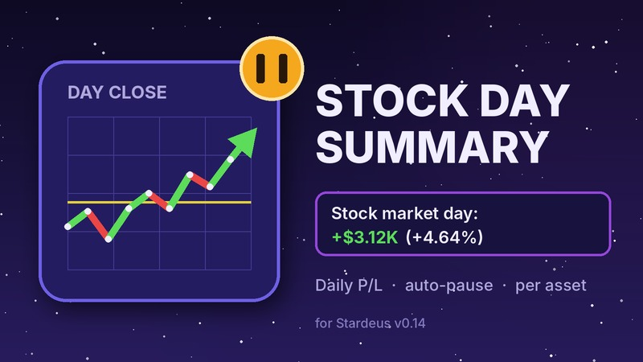

# Stock Day Summary

**English** | [Русский](README.ru.md)

[](https://github.com/Gesugao-san/stardeus-stock-day-summary/actions/workflows/ci.yml)

A [Stardeus](https://store.steampowered.com/app/1380910/Stardeus/) mod for **v0.15** and **v0.14**: at the end of
every stock market day it shows how much your portfolio gained or lost, and can pause the game.



## Features

- A notification (on v0.14, an entry in the **Events** list), e.g. `Stock market day: +$3.12K (+4.64%)`,
  green or red.
- Click it for details: day result, portfolio value, profit realized by sales, unrealized profit,
  per-asset breakdown, and which chart days were compared.
- The same line in the event log.
- Optional auto-pause when the summary appears.
- Optional autosave right before the day closes: the game's own autosave, 10 game minutes before the
  boundary, while the old prices are still in place. It takes a slot in the game's autosave rotation,
  once per game day.
- Each sale and each day's prices are written to `Player.log` (lines start with `[StockDaySummary]`),
  so any number can be checked.

## How it counts

Stardeus changes prices once per market day, at the day boundary. The day result compares the price
that held during the finished day with the new price:

```
day result = (value at the new prices + proceeds of same-day sales)
           − (value at the old prices + cost of same-day purchases)
```

Shares bought during the day count from their purchase price, shares sold during the day count at
their sale price. Old prices come from the game's own price history, so the summary is correct right
after loading a save. Only sales made *before* loading are unknown to the mod.

## Settings

- **v0.15:** Settings → **Stock Day Summary**, a tab of the game's own settings window (main menu and
  pause menu).
- **v0.14:** Main Menu → **Mod Settings** → Stock Day Summary. If
  [Modding Overhauled](https://steamcommunity.com/sharedfiles/filedetails/?id=3566425397) is installed,
  the page appears in its *Mod Settings* menu, otherwise the mod adds its own *Mod Settings* button.

| Option | Default |
|---|---|
| Pause on stock day summary | on |
| Open details window immediately | off |
| Report days without stocks | off |
| Autosave before the day closes | off |

Options are stored in the game's global `Settings.txt`.

## Install

- **[Steam Workshop](https://steamcommunity.com/sharedfiles/filedetails/?id=3829155679):** subscribe and enable the mod in Main Menu → Mods.
- **Manually:** put the mod folder into
  `%USERPROFILE%\AppData\LocalLow\Kodo Linija\Stardeus\Mods\StockDaySummary`
  (needs `ModInfo.json`, `ModCover.jpg`, `Translations\` and `0.15\Libraries\StockDaySummary.dll`
  and/or `0.14\Libraries\StockDaySummary.dll`), then enable it in Main Menu → Mods.

The mod stores nothing in saves, so it can be added to a running game and removed at any time.

The game looks for `Libraries` in a folder named after its own version first (`0.15\`, then `0.14\`, …,
then the mod root), so one mod folder serves both game versions.

## Build

Requires the [.NET SDK](https://dotnet.microsoft.com/download) and an installed copy of Stardeus
(the build references `Stardeus_Data/Managed/*.dll`). It builds for the game version that is installed:

```cmd
build.cmd                          :: v0.15
build.cmd 0.14                     :: v0.14 (switch Stardeus to the v0_14_x branch in Steam first)
build.cmd 0.15 "D:\Games\Stardeus"  :: if the game is not in the default Steam folder
```

The DLL is written to `0.15\Libraries\` or `0.14\Libraries\`. Commit it together with the code
change: CI can't build it, so releases ship the DLLs from the repository.

Tests for the profit/loss math run without the game:

```cmd
dotnet run --project Tests
```

On every push, GitHub Actions runs these tests and `.github/scripts/check_mod.py`: strict `ModInfo.json`,
matching keys and `{0}` placeholders in all translations, every key used in code translated, every
game version folder complete, cover size, and each committed DLL built for its game version with
the `ModInfo.json` version.
The mod DLL itself is built locally only, since it needs the game's own DLLs.

### Release

1. Raise `ModVersion` in `ModInfo.json` and the version in `Code/Shared/AssemblyInfo.cs`.
2. Add a `## <version>` section to [CHANGELOG.md](CHANGELOG.md): it becomes the release notes.
3. Rebuild both DLLs (`build.cmd 0.15`, `build.cmd 0.14`) and commit them.
4. Actions → **Release** → *Run workflow*, or push the tag `v<version>`.

The workflow runs the checks and tests, packs `StockDaySummary-<version>.zip` (a mod folder ready to
unpack into `Mods`) and creates a draft release; publish it on the Releases page.

### Layout

| Path | What |
|---|---|
| `Code/Shared/` | Code for both game versions |
| `Code/Shared/Core/DayPnlCalculator.cs` | Pure profit/loss math, no game types |
| `Code/Shared/StockDaySummarySys.cs` | Game system: listens to the market day change, builds the summary |
| `Code/Shared/SummaryPresenter.cs`, `SummaryText.cs` | Texts, log line, details dialog, pause |
| `Code/Shared/PreCloseAutosave.cs` | Autosave before the day closes |
| `Code/Shared/Market/` | Price history lookups, sale tracking (Harmony patch on `MarketPortfolio.Sell`) |
| `Code/V015/` | v0.15 UI: notification, settings tab, `[SelfInit]` registration |
| `Code/V014/` | v0.14 UI: Events list entry, *Mod Settings* page and menu integration |
| `Translations/` | English and Russian texts |
| `0.15/`, `0.14/` | Built DLLs, one per game version |
| `CHANGELOG.md` | Changes per version; release notes come from here |
| `Artwork/make_cover.py` | Renders `ModCover.jpg` |

Before uploading to the Workshop, the game rejects mods that contain dot files or folders
(`.git`, `.gitignore`, `.vscode`), so upload from a clean copy of the mod folder.

## License

[MIT](LICENSE)
